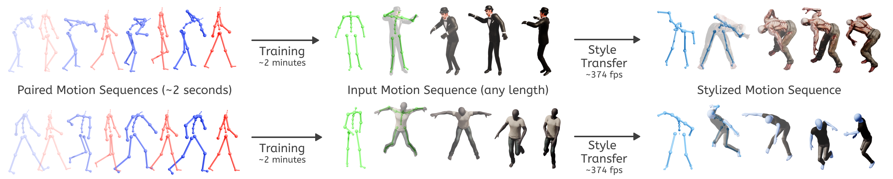

<div align="center">

# STyMo: Fast and Controllable Few-Shot Motion Style Transfer <br> SIGGRAPH 2026

[Jose Luis Ponton](https://joseluisponton.com/)<sup>1,2</sup>, [Alexander Winkler](https://alex-winkler.com/)<sup>1</sup>, [Ladislav Kavan](https://www.cs.utah.edu/~ladislav/)<sup>1</sup>, [Yuting Ye](https://www.yutingye.info/)<sup>1</sup>, [Petr Kadlecek](https://github.com/petrkadlecek)<sup>1</sup>

<sup>1</sup> Reality Labs, Meta  
<sup>2</sup> [Universitat Politècnica de Catalunya (UPC)](https://www.upc.edu/en)

[**Paper (ACM DL)**](https://doi.org/10.1145/3811356) | [**Project page**](https://jlpm22.github.io/stymo-project-page/)



</div>

## Overview

Supporting a wide variety of motion styles is critical for creating diverse virtual characters, but current methods either require large stylized datasets or pre-trained models that cannot generalize beyond their training distribution. 

We present STyMo, a few-shot approach that learns motion style from only seconds of paired data and trains in one to two minutes. 

Our key insight is to decompose style into two components: a static component capturing time-invariant posture, and a temporal component capturing frame-wise dynamics. This decomposition yields an interpretable system where posture intensity, temporal exaggeration, and per-body-region style can be adjusted at runtime. Furthermore, the reduction in required training data and computation time structurally permits an iterative authoring workflow.

## Quick Start

For detailed command-line options and interactive GUI reference, see [USAGE.md](USAGE.md).

### 1. Installation

1. Create a virtual environment:
   ```bash
   py -m venv env
   ```

2. Activate the virtual environment:
   * **Windows**:
     ```bash
     .\env\Scripts\activate
     ```
   * **macOS/Linux**:
     ```bash
     source env/bin/activate
     ```

3. Upgrade pip:
   ```bash
   py -m pip install --upgrade pip
   ```

4. Install PyTorch (refer to the [official PyTorch installation guide](https://pytorch.org/get-started/locally/) for your CUDA configuration).

5. Install required packages:
   ```bash
   pip install -r requirements.txt
   ```

6. Install [Blender](https://www.blender.org/) (needed to execute the app).

---

### 2. Training a Model
Train a style transfer model using paired source (neutral) and target (stylized) motion clips:
```bash
py .\src\stylizer_train.py .\motion\mocha\angry\ .\motion\mocha\neutral\ --epochs 100 --name test
```
*Note: Training only builds and saves the model. All testing and inference is performed interactively through the application (`stylizer_app.py`). For a detailed list of all training options, arguments, and outputs, see the [Training Options section in USAGE.md](USAGE.md#training-options).*

---

### 3. Running the Interactive Application
Launch the graphical GUI to apply and control style parameters in real-time:
```bash
py .\src\stylizer_app.py .\motion\mocha\angry\results\Transformer-test\
```
*Note: The application results will be placed as indicated in the [Data](#data) section. For details on the interactive GUI controls and command-line options, see the [Application Usage section in USAGE.md](USAGE.md#application-usage).*

---

### 4. Extracting Custom Static Poses (Optional)
After running the application, you can extract custom average poses from specific frames to refine the static style:
```bash
py .\src\extract_average_pose.py .\motion\mocha\angry\results\Transformer-test\ --interactive
```

Then retrain to incorporate the custom poses:
```bash
py .\src\stylizer_train.py .\motion\mocha\angry\ .\motion\mocha\neutral\ --epochs 100 --name test
```
*For command-line mode examples, options, and output folders, see the [Extract Average Pose Tool section in USAGE.md](USAGE.md#extract-average-pose-tool).*

## Data

Motion sequences are organized in the `motion` directory. Paired source and target directories must contain BVH files with matching filenames and frame counts.

```
motion/
└── mocha/
    └── angry/                      # Style directory (e.g., angry, proud, robot)
        ├── source/                 # Source motion clips (neutral style)
        │   ├── clip_001.bvh
        │   └── clip_002.bvh
        ├── target/                 # Target motion clips (stylized)
        │   ├── clip_001.bvh        # Must match source filenames
        │   └── clip_002.bvh
        ├── sourceStatic/           # (Optional) User-provided static source poses
        │   └── 0.bvh               # Created by extract_average_pose.py
        ├── targetStatic/           # (Optional) User-provided static target poses
        │   └── 0.bvh               # Must match sourceStatic filenames
        └── results/                # Automatically created during training
            └── Transformer-test/   # Experiment results
                ├── model.pt        # Trained model
                └── app_results/    # Predictions saved from stylizer_app.py
```

## Folder Structure

All source code is located in the `src/` directory:

* **Primary Scripts**:
  * **`stylizer_train.py`**: Trains the style transfer model using a three-phase approach (static classifier, gating model, and temporal transformer).
  * **`stylizer_app.py`**: Interactive GUI application for real-time style control, including style weights, body-part masking, and postprocessing.
  * **`stylizer_inference.py`**: Core inference logic, including contact-aware optimization to preserve physical plausibility.
  * **`extract_average_pose.py`**: Helper tool to extract static poses from BVH files to refine target postures.
  * **`visualize_bvh.py`**: Standalone helper utility to render BVH files in Blender.

* **Models**:
  * **`model_temporal.py`**: Transformer-based encoder-decoder model for temporal dynamics.
  * **`model_static.py`**: Neural network classifier (`AveragePoseModel`) representing static posture style.
  * **`model_gating.py`**: Stylizability Gate predicting whether a pose is in-distribution (should be stylized) or out-of-distribution.
  * **`motion_loss.py`**: Loss functions (reconstruction and contact-aware loss).

* **Data Processing & Utilities**:
  * **`utils_training_data.py`**: Data loading, data augmentation, and dataset preparation.
  * **`utils_inference.py`**: Rotation smoothing, style interpolation, and delta loading.
  * **`features.py`**: Feature extraction and kinematics utilities.
  * **`body_parts.py`**: Joint indices definitions for body-part specific control.
  * **`standardize.py`**: Feature standardization helper.
  * **`utils.py`**: Generic BVH parsing and processing helpers.

## How it Works (in short)

* **Style Decomposition**: STyMo decomposes style into two parts: a **static component** (representing average postures) and a **temporal component** (representing motion dynamics).
* **Three-Phase Training**:
  1. **Static Model**: Trains a classifier to capture posture differences and global shifts.
  2. **Gating Model**: Learns a confidence boundary using nearest neighbors. If an input pose is too far from the training data, the gate scales down the style intensity to avoid artifacts.
  3. **Temporal Model**: Trains a sequence-to-sequence Transformer to map dynamic movement details.
* **Runtime Control**: Provides real-time interactive adjustments for dynamic intensity, static posture weight, localized body-part masks, and contact-preservation optimization.

## Troubleshooting

* **ModuleNotFoundError on custom modules (e.g., `model_temporal`)**:
  * Make sure to run all scripts from the project root directory using `py .\src\<script>.py`. Running from inside `src/` will cause imports to fail.
* **ModuleNotFoundError: No module named 'pymotion'**:
  * Ensure that the virtual environment is activated (`.\env\Scripts\activate`) before running the training or application scripts.
* **Foot Sliding or Ground Penetration**:
  * Adjust the **Postprocessing** slider in the GUI to **Normal** or **High** to run contact-aware optimization.

## Citation

If you use this project or find our research helpful, please cite our SIGGRAPH 2026 paper:

```bibtex
@article{2026:ponton:stymo,
	author = {Ponton, Jose Luis and Winkler, Alexander and Kavan, Ladislav and Ye, Yuting and Kadlecek, Petr},
	title = {STyMo: Fast and Controllable Few-Shot Motion Style Transfer},
	year = {2026},
	publisher = {Association for Computing Machinery},
	booktitle = {SIGGRAPH 2026},
	address = {New York, NY, USA},
	issn = {0730-0301},
	doi = {10.1145/3811356},
	journal = {ACM Trans. Graph.},
}
```

## License

This project is released under the MIT License. See `LICENSE` for details.
